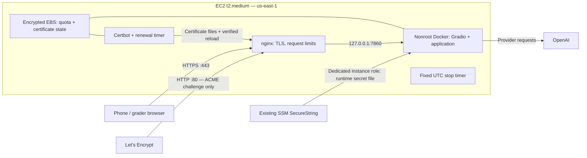

# Direct EC2 HTTPS proposal — issue 28

Status: researched design proposal, not implemented or deployed. Prepared 2026-11-11
at Imran's request to explore EC2 hosting after the failed CloudFront stack.
No additional AWS resources were created for this exploration. The previous deployment
approval and failed attempt remain recorded separately; this document is not sign-off.

## Recommended first release

Use one course-permitted `t2.medium` (4 GiB) in us-east-1, the existing encrypted
provider parameter and the existing Docker application. Remove CloudFront entirely.
Keep nginx as the reverse proxy. Use Certbot 5.4 or newer with Let's Encrypt's public
IP certificate support, pinning a tested release during implementation.

Network changes: admit public TCP 443 for the site and TCP 80 for certificate validation
and HTTPS redirection. Keep SSH and port 7860 closed externally. The prior CloudFront
prefix-list ingress rule is removed. This is a material ingress change to review before
launch. No new broad course IAM privileges are required by the proposed architecture;
actual launch, Session Manager and certificate validation still require execution tests.

## Address and certificate choice

Start with the instance's auto-assigned public IP and a trusted IP certificate. A grader
can use `https://<public-ip>/` from a phone or computer. A domain purchase and DNS service
are unnecessary for this first release. Do not use a self-signed certificate, browser
warning bypass, an unencrypted public chat endpoint, or a temporary Gradio share tunnel.

The IP can change after EC2 stop/start. Resume must discover the current IP, obtain or
select the matching certificate, and update the grading link before marking the app ready.
This is suitable for an initial uninterrupted grading window, not a stable permanent URL.
If continuity across stop/start becomes necessary, evaluate an owned domain or Elastic IP
as a separate decision. Elastic IPs retain their hourly charge while the instance is stopped;
do not reserve one indefinitely under the $30 total budget without accounting for it.

Let's Encrypt IP certificates last 160 hours (about 6.7 days). Certbot's IP flag requires
5.3+, and webroot IP validation requires 5.4+. Use the shortlived profile and webroot
validation, so nginx can remain running during renewals. Certbot presently obtains the
certificate; nginx installation/reload must be configured explicitly.

Before automatic issuance, review and obtain any required approval for the certificate
subscriber agreement. The public IP/certificate is public information; the OpenAI key
must never be sent to the CA. Account, certificate and private-key files stay on encrypted
EBS with restricted permissions, outside source and image layers.

## Startup and failure behavior

1. Install the fixed UTC stop timer before downloads/build. Use standard CPU credits.
2. Start nginx in ACME-only mode: serve challenge files on port 80; other HTTP requests
   return unavailable. Do not proxy the chat over HTTP while provisioning certificates.
3. Build the pinned app image and retrieve the key through the existing narrow SSM role.
4. Obtain and verify a publicly trusted certificate for the actual public IP. On failure,
   leave the public app unavailable and report the failure; no HTTP/self-signed fallback.
5. Test nginx configuration, enable TLS, then redirect normal HTTP requests to HTTPS.
6. Schedule renewal at least twice daily and use a successful-renewal hook to test/reload
   nginx. Check actual presented certificate expiry and renewal health. Do not restart
   the application container during certificate renewal.
7. At stop/start, block readiness until IP/certificate checks pass. Never serve a stale
   certificate for the old address. Sessions/preferences remain process-local; quota is
   a separate persistent mount and must retain its counts.

The seven-day window exceeds the certificate's lifetime: an initial successful TLS
handshake alone is insufficient. Validate the renewal timer, a staging renewal dry run,
reload hook, and actual production expiry monitoring before calling this ready.

## Cost and operating window

Planning arithmetic, no credits/free tier assumed:

| Component | Seven days | Assumption |
|---|---:|---|
| t2.medium Linux | $7.80 | 168 hours × $0.0464/hour, us-east-1 |
| One public IPv4 | $0.84 | 168 hours × $0.005/hour |
| 16 GiB gp3 disk | about $0.30 | Illustrative $0.08/GB-month, prorated on a 30-day month; confirm actual region rate |
| Fixed subtotal | about $8.94 | Excludes transfer, taxes, other account usage and residual storage |

OpenAI usage is separately billed. Existing 60/day and 300/lifetime action limits and
completion caps remain, but are not dollar meters. nginx adds per-client request limits;
neither this nor a stop timer guarantees a hard AWS billing cap.

Keep the proposed initial seven-day stop. Disk continues billing after stop; auto-assigned
IPv4 is released. Budget monitoring and cleanup remain necessary. Continuous t2.medium
server time for 30 days alone is $33.41, exceeding $30 before other costs. Availability
through March 30, 2027 needs a separate schedule/credit/budget decision and confirmation
of course-lab expiry; this proposal does not promise continuous service until then.

## Versioning and code scope

No business logic or UI redesign is needed. Changes are confined to the infrastructure
template, nginx TLS config, pinned Certbot installation, certificate/renewal startup and
the deployment runbook. Reuse the existing secret-file mount, persistence, public sample
acknowledgement, quota, token caps, container hardening and operational metadata.

First validate one v1 container at `/`. Preserve the immutable v0 checkpoint. Later `/v0`
and `/v1` routing can use separate pinned containers and Gradio root-path configuration;
that routing and isolation need explicit tests and are not implemented by this proposal.

## Implementation and release checks

- Amend the template to remove the distribution/prefix-list dependency and add reviewed
  80/443 ingress. Use a new stack name; preserve the original rollback evidence.
- Independent review of exact bootstrap, TLS/renewal configuration and IAM/ingress diff.
- Validate template, nginx and shell syntax; verify image build on the actual EC2 host.
- Confirm HTTPS trust on desktop/iPhone without warning bypass, HTTP challenge/redirect
  behavior, closed SSH/7860, secret-file exclusions and certificate/private-key permissions.
- Verify real catalog, identity interruption/ownership, tables/suggestions, correct version
  metadata, streaming, session reset, controlled container restart and quota persistence.
- Record instance/AMI/image IDs, deployment revision, expiry/renewal evidence, exact stop
  time and the public link. Distinguish infrastructure checks from existing app evaluations.
- Capture required action-time approvals for changed public ingress/certificate agreement
  when the amended deployment is concrete; do not re-request the already approved key use.

## Sources checked 2026-11-11

- [AWS T2 pricing/specifications](https://aws.amazon.com/ec2/instance-types/t2/)
- [AWS public IPv4 pricing](https://aws.amazon.com/vpc/pricing/)
- [AWS gp3 pricing method](https://aws.amazon.com/ebs/pricing/)
- [Elastic IP behavior and stopped-instance charges](https://docs.aws.amazon.com/AWSEC2/latest/UserGuide/elastic-ip-addresses-eip.html)
- [Let's Encrypt public IP certificates and 160-hour lifetime](https://letsencrypt.org/2026/01/15/6day-and-ip-general-availability)
- [Official Certbot IP/webroot support and configuration guidance](https://letsencrypt.org/2026/03/11/shorter-certs-certbot.html)
