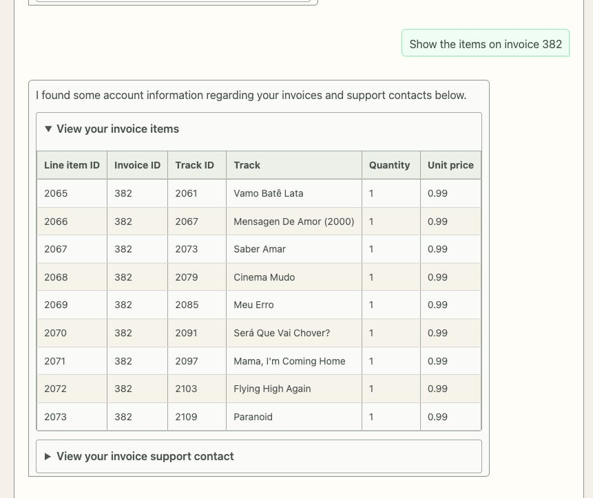
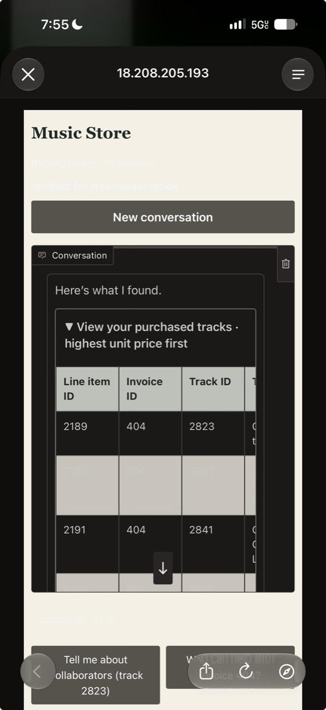
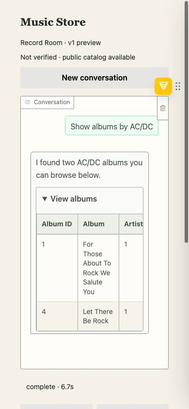

# Developing the Music Store Assistant with AI Agents

[Download the illustrated Word document](music-store-development-narrative.docx)

Imran Baig | Agentic AI capstone | November 2026

For my capstone, I built a Music Store Assistant that helps customers discover music, retrieve purchase information and save music preferences. I also wanted to practice a disciplined way of developing with AI agents: specifications before implementation, independent reviews and evidence that the system works.

## How I used Codex

I used Codex as an implementation collaborator for requirements analysis, architecture, coding, testing, evaluation and deployment. The implementation was substantially AI-assisted. My role was to define the customer experience, question design choices, review specifications and demonstrations, test the application myself, and approve milestones and merges.

The development workflow used a primary authoring agent and separate read-only reviewer sessions. I retained final authority over human findings and any reviewer findings I adopted. Other agent findings could be accepted or declined with a recorded explanation.

*Figure 1  Development workflow. Reviewer sessions are distinct from the application agents. Tests and agent reviews inform approval; they do not constitute human sign-off.*

GitHub Spec Kit organized the specification artifacts. Git commits, pull requests, review records, test outputs and screenshots made the work traceable. The reviewer roles were assigned per review; this diagram does not imply a continuously running autonomous team or a proven issue listener.

## The application agent stack

The running assistant is a separate agent system from the Codex development workflow. Its services enforce identity, scope requests and record tool results; the models reason within those boundaries. The diagram reflects the implemented v1 architecture.

*Figure 2  Runtime architecture. OpenAI gpt-4o-mini is the default configured model. Separate logical roles use that model; the diagram does not imply different model vendors or sizes.*

Catalog browsing is public. Account requests pause for a sample customer ID, email or phone, then resume with server-verified identity. This is a demonstration using fictional Chinook records, not production authentication. Domain tools enforce ownership independently of model-generated arguments.

## Specifications and the customer experience

I selected GitHub Spec Kit to structure specification-driven development. We reconciled the course guide and rubric, defined customer use cases, documented subsystem boundaries and established acceptance criteria before progressing through implementation milestones.

I requested wireframes and realistic walkthroughs before committing to the redesigned interface. Actual sample questions and responses helped me judge the experience more effectively than abstract layouts. I also asked for a boundary between the Gradio view, presentation logic and application services so future visual changes would not require rewriting agent orchestration or database tools.

### Making correct answers useful

An early challenge was that technically correct answers could still feel unhelpful. For example, a request for an artist’s “most popular” song could produce catalog matches without acknowledging the missing ranking data. I asked for concise, natural explanations of these limitations, followed by relevant alternatives.

We introduced a hybrid response approach. A constrained LLM writer creates a short introduction, and a separate model gate checks it against allowed evidence. Exact facts remain in deterministic, expandable tables. Failed or rejected narration falls back to deterministic text. The writer and gate have no database tools, and their judgments remain probabilistic.

*Figure 3  Actual deployed invoice response after verification. The customer can expand the factual table, while the surrounding prose stays brief. The crop is from the live desktop validation capture, not a mockup.*

I also requested persistent contextual suggestions near the composer. Suggestions use observed tool facts and only prefill a draft; the customer still chooses when to send it. This improved discoverability without giving the UI authority over identity or account access.

## A phone test exposed a contrast bug

Hands-on testing on my phone uncovered a problem that desktop acceptance checks had missed. Gradio adopted dark-mode text and controls, while custom page and alternating table backgrounds remained cream. Some rows and status text became nearly unreadable.

We reproduced the device-dark setting, made the approved light palette consistent, and explicitly paired table text with both row backgrounds. The repaired page was inspected at a 390-pixel viewport with dark mode enabled. Measured contrast for the two row styles was 14.55:1 and 13.13:1.

| Before — reported on iPhone | After — browser verification at phone width |
| --- | --- |
|  |  |

*Figure 4  The left image is the submitted iPhone screenshot. The right image is a real browser capture at 390 pixels with dark mode forced; it is not a physical-iPhone retest. The table remains horizontally scrollable on narrow screens.*

This experience reinforced that automated tests cover only part of product quality. I needed to exercise the actual interface, inspect the rendered states and turn concrete observations into acceptance criteria.

## Deployment and integration challenges

The course AWS account restricted available resources. An initial deployment attempt failed because the requested instance type was not permitted. We inspected the actual permissions, selected a permitted t2.medium instance and removed the CloudFront dependency after encountering access restrictions. CloudFront creation itself was not attempted.

The deployed application uses Docker behind nginx on EC2, with a trusted Let’s Encrypt public-IP certificate. The provider key is read from AWS Systems Manager Parameter Store as an encrypted SecureString and mounted as a read-only secret file. Public-demo action limits, bounded model output and a scheduled stop helped manage costs, although none is a hard billing cap.

Infrastructure testing also revealed a mismatch between CI and the host: nginx’s parser needed permission to bind ports 80 and 443. Improved diagnostics exposed the cause, and the isolated CI hosting job was aligned with the root-executed host check. A test failure was investigated rather than bypassed.

### Keeping the submitted code consistent

Stacked pull requests created a final integration challenge. Several PRs showed as merged but had landed in parent feature branches rather than main. We checked Git ancestry and file differences, created a final integration PR, and verified that the application code in main and my local checkout matched the deployed revision.

Another lesson concerned progress communication. At one stage, I expected the redesigned interface to be available while the work had mainly established its presentation boundary. I learned to ask whether a milestone represented a design, a structural change, visible behavior or a validated release.

## Validation and lessons learned

The application reached 431 passing automated tests, supplemented by live-model evaluations, independent agent reviews and browser walkthroughs. These are different kinds of evidence. The broader live evaluation had previously scored 14 out of 16, so I did not treat a green test suite as proof that every conversational scenario worked perfectly.

My main takeaway is that effective AI-assisted development needs clear decision rights and traceable evidence. Codex helped me work across unfamiliar areas quickly. The strongest results came when I paired that capability with concrete requirements, realistic examples, independent review and direct testing of the customer experience.

### Project and supporting records

Public source and setup: github.com/imbaig/ik/tree/main/capstone
Submission main revision: b81ec78
Deployed application revision: e71bb64
Review workflow: capstone/docs/development-review-workflow.md
Release and verification: capstone/deployment/aws/launch-2026-11-12.md
Contrast evidence: capstone/docs/reviews/v1-dark-mode-contrast.md

Supporting records: [review workflow](../development-review-workflow.md), [launch record](../../deployment/aws/launch-2026-11-12.md), and [contrast repair review](../reviews/v1-dark-mode-contrast.md).
