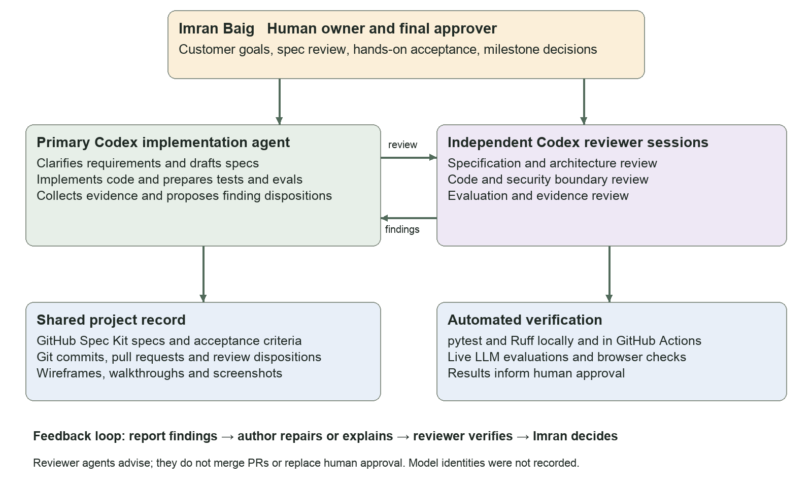
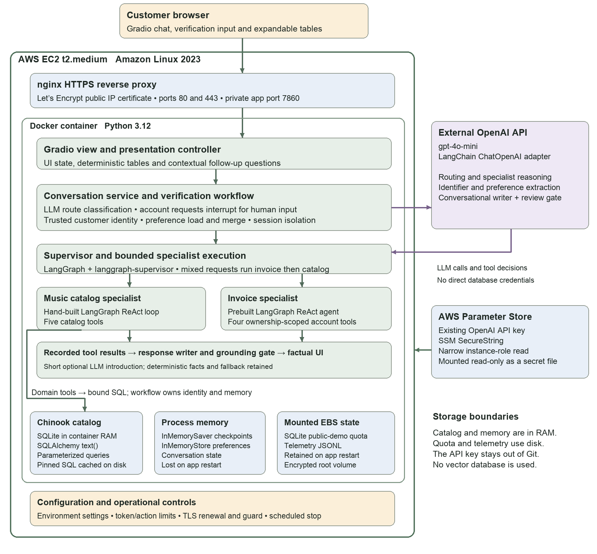

# Developing the Music Store Assistant with AI Agents

By Imran Baig, November 2026.

[Download the illustrated development narrative](music-store-development-narrative.docx)

The five-page report describes how I used Codex for specification-driven development,
implementation, independent agent reviews, validation and AWS deployment. It identifies
my decisions and approval role, distinguishes the development agents from the application
agents, and discusses challenges with conversational responses, mobile contrast, cloud
permissions and stacked pull-request integration.

It includes actual application screenshots and an explicitly labeled before/after contrast
comparison. The before image was reported on an iPhone; the after image is a browser
verification at phone width with dark mode enabled.

The report records application revision `e71bb64` and submission main revision `b81ec78`.
This documentation addition does not change the deployed application. Automated test
results, live evaluations and human acceptance are distinct forms of evidence.

## Development agent stack

## Application architecture

Supporting records: [review workflow](../development-review-workflow.md),
[launch record](../../deployment/aws/launch-2026-11-12.md), and
[contrast repair review](../reviews/v1-dark-mode-contrast.md).
