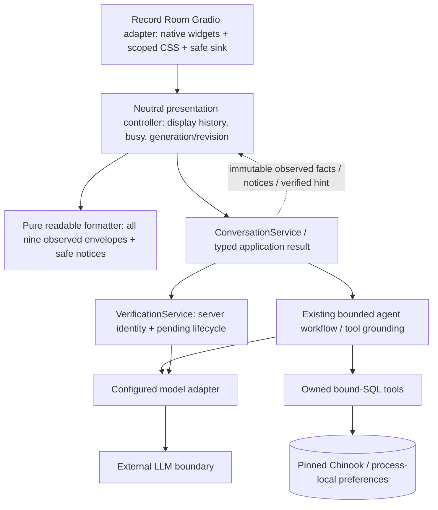

# Record Room v1 — integrated application, issue13

User-authorized delivery follows the verified issue12 package, draft PR14 at
`722e26ce145f722887230295d61803d18fe8ab9f`, stacked on still-unmerged PR9
`7d137081b579b49128068d9dcc4be009cfea9def`. DirectionA and Gradio are selected by
Imran for this scoped implementation. No merge or final visual/accessibility acceptance
is implied. Issue8 is incorporated here, with no competing slice. Issues10/11 remain
explicitly deferred until before demo; original14/16 live evidence is retained.

## Run the actual app

From `capstone`, use Python3.12 and locked dependencies with ignored local caches:

```sh
UV_CACHE_DIR=.cache/uv PIP_CACHE_DIR=.cache/pip uv sync --locked
UV_CACHE_DIR=.cache/uv uv run python app.py
```

The normal entrypoint requires the locally configured application provider key; no key
is supplied or sought in cloud. `app.py` still builds real ConversationService,
VerificationService, model adapter, bounded graphs/tools and verified Chinook database.
No fixed P0 response handlers are used. `tests/ui_harness.py` is a historical test-only
harness; for deterministic container validation use the corrected explicit Docker smoke
target from PR14, never the default production entrypoint.

The v1 branch changes Docker/version labels to `v1.0.0-preview`; use **distinct** image
names, ports and processes:

```sh
V1_SHA=$(git rev-parse HEAD)
docker build --target production --build-arg PACKAGE_REVISION="$V1_SHA" -t "capstone-v1:$V1_SHA" .
docker build --target smoke --build-arg PACKAGE_REVISION="$V1_SHA" -t "capstone-v1-test:$V1_SHA" .
python deployment/check_container.py --production "capstone-v1:$V1_SHA" \
  --smoke "capstone-v1-test:$V1_SHA" --revision "$V1_SHA" --port 17861
```

Managed-cloud builds add the BuildKit CA secret documented in
[deployment README](../../deployment/README.md). The older README/manifest describe
immutable v0; this document specifies the v1 image names/version. Runtime login/secret
injection and localhost binding remain as reviewed in PR14. Do not overwrite v0 tags,
images, Mac checkout or running process. No hosting or new application API layer.

## Integrated behavior and boundary



No Gradio objects, customer IDs or new authority move into the core contracts. The
verified badge is only the server result's boolean projection, never an authorization
input. Reset/expiry clears that projection. Application services independently validate
all actions. Cancel verification abandons a waiting task; no in-flight provider abort is
promised. Busy disables submit/reset and duplicate calls remain rejected server-side.

The empty welcome has zero messages/results and editable prompt suggestions. Sending
uses the actual application and hides welcome. Account requests invoke real verification,
retry/error/cancel/catalog-only outcomes. Identifier responses are redacted from display
history. Owned invoice results offer an editable follow-up based on an actually returned
invoice ID, such as382. Switching identity is refused with New conversation guidance.
New conversation asks confirmation; Keep does not reset; confirmation clears chat and
identity, preserving process preferences. No checkout/playback/refund/ticket/delete UI.

All nine tool envelopes render as ordered readable records with human labels, all returned
fields (including nulls), exact observed values/IDs/decimal strings/quantities and metadata.
Genre totals and representative-artist sample are distinct. No currency is inferred,
totals recomputed, rows deduplicated or model answer promoted to fact. Empty/error/partial
outcomes stay explicit. Separate typed notice strings preserve application-generated
refund/cancel/memory/failure notices; no JSON is parsed out of prose. Memory-only and
verification replies retain the existing trusted application text, escaped at the sink.

The legacy plain-text formatter remains for service history/evaluation compatibility;
legacy SQL-truth, routing, budget and provider reliability tests are not rebaselined.
Agent runtime adds only explicit safe failure-notice metadata, no prompt/control changes.
No extra formatting model call. Pure formatting is framework independent. Customer and
store strings are escaped for HTML/Markdown; sanitization, no arbitrary tags/downloads
remain enabled. Browser XSS/assistive-technology testing is pending, not inferred from
Python escaping assertions.

## Acceptance evidence and local handoff

Automated tests: `tests/test_readable.py` checks all nine actual SQL-backed envelopes,
field/order/count/truncation/decimal preservation, nullable/long/malicious values, URLs,
foreign versus absent invoice equivalence, partial errors, actual-service verification/
invoice/switch/reset isolation, mixed/refund notices and catalog-only cancellation.
Existing neutral fake-view/stale/reset/session/memory/evaluation suites remain intact.
`tests/test_ui.py` now checks the intended readable sink while retaining sanitization.
Gradio Blocks construction/callback configuration is exercised, not rendered visual QA.

**Pending local coordinator:** exact final-SHA actual desktop/mobile screenshots and
keyboard/focus/reflow/VoiceOver checks, plus affected real-provider lifecycle evaluation.
Cloud has no configured application key; no live provider calls or visual QA performed.
Runtime network restrictions remain recorded; official Nielsen/HAX/WCAG primary sources
were parent-retrieved, not freshly inspected here. See the design source provenance.
Target WCAG2.2AA, no conformance claim. In particular, status announcements and focus
restoration must be verified with assistive technology, not assumed from native widgets.

Compare actual screenshots against [selectedA walkthrough](../design/issue-5/visuals/direction-a.html#a-S01),
[flow key](../design/issue-5/flow-guide.md) and [acceptance](../../specs/002-customer-experience/acceptance.md):

| Capture / check | Required evidence; currently pending |
|---|---|
| S01 entry / S17 catalog |1440x900,390x844; zero messages initially, prompt edit then grounded result, counts/sample, long text |
| S03–07 verification |Account task, invalid/unknown/retry limit, retry success, cancel; no existence/candidate leak |
| S09/S18/S20 owned / verified |Exact invoice382 and item values, trusted badge, verified shortcut, editable follow-up |
| S08/S10 mixed |Account then catalog, catalog-only exit, partial provider failure and recoverable status |
| S11 empty/error |No results versus unavailable; retained exact returned counts, no invented completion |
| S12/S15 reset/switch |Refusal consequence, Keep preserves, Confirm clears identity/transcript; two tabs and stale output |
| S13/14 memory / S16 support |Observed taste save/recall and process limit, owned contacts only, unsupported-action honesty |
| Responsive / keyboard / AT |320px,768px,1440px,390px,zoom200%,landscape/virtual keyboard; tab order, visible focus, no lost facts, status announcement and recovery focus |

Intentional visual differences awaiting human review: native Gradio chat bubbles/controls
and vertically stacked field records replace custom HTML cards; no artwork or unsupported
production controls. Context rail collapses on narrow screens; critical disclosures remain
in the main column. This is a runnable integrated v1 candidate, not a claim of final design
parity, accessibility conformance, human closure or deployment approval.
