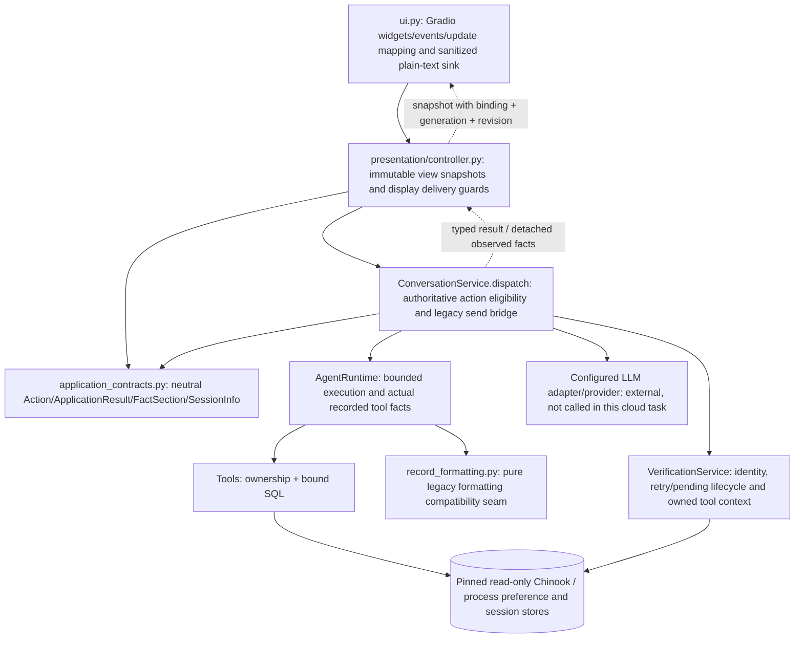

# Issue7 / A0 — implemented presentation boundary

Issue [7](https://github.com/imbaig/ik/issues/7), parent4; first implementation slice after
PR6 merged by Imran. Base main `6f7ba7dd87d1f0e6be9fed2e439d07918374bbaa`.
Selected directionA and Gradio feasibility/proceeding are human decisions; no reapproval is
requested for this authorized slice. Issue8 remains queued. One active implementation PR.

**Structural slice, not the final selectedA layout or new readable fact formatting.**
No dependency/framework/API/Microsoft-MVVM change, no P0 fixed-fixture callbacks. Production
`app.py → build_ui(real ConversationService)` remains the composition path. Verification,
identity, pending task, checkpoints, agent budgets, SQL/tool guards and process preference
policy remain in the existing server services. No application key/provider calls in cloud.

## Boundary and sequence



```mermaid
sequenceDiagram
  participant View as Gradio / fake view
  participant Display as PresentationController
  participant App as ConversationService
  participant Verify as VerificationService
  View->>Display: Send(question)
  Display-->>View: immutable Busy snapshot (indeterminate)
  Display->>App: dispatch(server handle, typed Action)
  App->>Verify: existing authoritative gate
  App-->>Display: ApplicationResult(status, session hints, facts, compatibility text)
  Display-->>View: current binding/generation/revision result only
  View->>Display: Send(identifier) or explicit ResumeVerification
  Display->>App: dispatch; server rechecks waiting state
  App->>Verify: real interrupt/resume/retry
  App-->>Display: grounded result + detached envelopes
  Display-->>View: same legacy plain-text facts; identifier not retained in transcript
  View->>Display: New conversation (not a provider abort)
  Display->>App: reset only when display is not busy
  App->>Verify: invalidate old handle and allocate fresh unverified session
  Display-->>View: clear private projection; increment generation
```

## Implemented versus deferred

| Responsibility | This slice | Deliberately deferred |
|---|---|---|
| Neutral application contract | Frozen typed actions, session display hints, result and detached JSON fact envelopes; real service implements dispatch/new/reset/close | Full notice-code migration away from compatibility text |
| Controller seam | No Gradio/provider/SQL imports; immutable history/results, busy/error snapshots, reset/expiry cleanup, per-view delivery identity + generation/revision and action sequence | FinalA composition, styling and new rich display sections |
| Gradio adapter | Maps neutral snapshots to existing seven outputs; same widgets and plain-text sink with sanitize_html=True, render_markdown=False, tags/downloads disabled | Markdown/rich-card sink or new escaping behavior |
| Formatter | Original render_records function moved verbatim to neutral record_formatting.py; runtime imports compatibility function and eval imports new location. Runtime still assembles legacy safe response text | Final human-readable nine-tool formatting and removal of compatibility text bridge |
| Authority | Real ConversationService/VerificationService continue all session, workflow, identity and ownership decisions; display hints cannot authorize an action | New auth, transport/API or persistence |

The shared neutral formatter keeps application/agents independent of presentation imports.
This is a staged extraction, not completion of every proposed002 design field. No grounded
fact prose, monetary representation/count/truncation/order or model policy was redesigned.
FactSection retains the exact observed envelope as detached immutable JSON; decoding yields
a fresh structure, never a parse of display text. Request correlation remains server-owned.
No customer identity is copied into view state or accepted from it.

Small intentional safety/recovery differences: identifier responses are replaced in display
history by `[verification response supplied]`; catalog-only is offered/accepted only for a
mixed pending task; expired backend handles clear old private display before fresh reset;
busy duplicate/reset callbacks produce no stale output. These are not new store features.
Cancel verification acts on a waiting gate only. Reset/close do not stop an in-flight provider;
application serialization/timeouts retain their existing role. Closing invalidates display
delivery before waiting for application close; suspended generators hold no view lock.

## Deterministic verification and evidence boundary

Dependencies synced with locked uv/Python3.12 using ignored project-local `.cache/uv` and
`.cache/pip`; lockfiles unchanged. New tests use fake views and deterministic model doubles
with **real ConversationService, VerificationService, LangGraph, domain tools and SQL**.
No P0 fixed-fixture handlers are used by production or these integration tests.

Meaningful regression coverage: blocked-Gradio-import subprocess drives real service actions;
verification/resume/retry bound and typed eligibility; mixed cancellation/catalog-only versus
later re-verification; owned invoice projections for two customers and switch/foreign invoice
refusal; detached exact values/metadata for all nine tools including error/empty/invalid cases;
process memory across reset and isolated recall; stale/foreign snapshots, reset/expiry, close
during real service work, abandoned generators and old iterator/new busy ordering. Existing
UI adapter tests continue; plain-text sanitizer/config flags are checked without claiming DOM QA.
The new cross-view delivery regression initially failed and led to per-binding snapshot identity.

Exact final tested SHA, commands/results, independent reviewer identity/report, author
findings/dispositions/rechecks and GitHub CI are recorded in the draft PR so recording them
does not mutate the reviewed source. Escalate after two failed repair/review cycles. Tests
and agent verification do not supply Imran's merge approval or human finding closure.

## Affected LIVE evaluation — REQUIRED / PENDING locally

No cloud app key configured or sought. No provider call performed. On exact final PR HEAD,
local coordinator must run affected verification/substitution, cancel/catalog-only, mixed,
reset/expiry/isolation and memory journeys against the real production service/model and
record SHA/source/cases hashes, model settings, outcomes and redacted semantic review.
The existing conversation_eval CLI still exercises legacy service.send; its formatter/
grounding checks are useful but **do not alone exercise the new controller/dispatch seam**.
Supplement it with real-app UI/typed-port live walkthroughs. Do not call scripted model or
fake-view runs live evidence. Any code repair requires affected evaluation/review again.

## Actual before/after desktop/mobile screenshots — PENDING coordinator

SelectedA reference: [directionA walkthrough](../design/issue-5/visuals/direction-a.html#a-S01),
[flow guide](../design/issue-5/flow-guide.md). Preserve the reviewed design artifacts.
Capture **actual runnable app**, not the portable mockup or a P0 fixed handler, at base main
and exact final PR revision. Record browser/device/viewport and SHA for each pair. Use public
sample customer1, no real credentials/customer records in captures; keep raw output ignored.
If deterministic models are used with the real service for screenshots, label them explicitly
and keep required provider evaluation separate. No cloud rendered screenshot claim is made.

| Before / after pair | SelectedA state reference | Expected A0 comparison / capture status |
|---|---|---|
| Empty landing at1440x900 and390x844 | A-S01 | Existing prototype heading/chat layout preserved; finalA warm paper/rail/hero not implemented. BOTH ACTUAL CAPTURES PENDING |
| Public catalog result and busy state | A-S02D/S17 | Same ordered JSON-row facts/counts and real working status; no new styled catalog cards. PENDING |
| Account question → verification → invalid/retry | A-S03/S04 | Same real pending task/verification; no private rows before gate; identifier transcript redacted. PENDING |
| Verified owned invoices / same-account follow-up | A-S09/S20 | Same exact invoice facts; no finalA card/table translation. PENDING |
| Mixed question → catalog-only / cancel | A-S03M/S07/S08 | Distinct real outcomes; catalog-only only for mixed pending query. PENDING |
| Switch refusal → New conversation and fresh verification | A-S15/S12-S15/S01R | No identity change by assertion, old private display gone; no new confirmation UI claimed. PENDING |
| Failure/empty, expiry, process memory recall | A-S10/S11/S13R | Honest existing outcomes, private stale delivery discarded; process-local lifetime unchanged. PENDING |

This checklist explains intentional deviations; it is not screenshot evidence. Local actual
captures and affected live evaluation remain outstanding acceptance evidence before merge.
No final visual/A accessibility conformance or complete002 acceptance claimed by this slice.

## Author verification commands (final SHA recorded in PR)

From capstone with project-local ignored UV_CACHE_DIR/PIP_CACHE_DIR, locked dependencies:

- `uv sync --locked --python 3.12`: passed, no dependency changes.
- `uv run --locked pytest -q tests/test_presentation.py tests/test_ui.py tests/test_verification.py tests/test_agents.py tests/test_memory.py tests/test_conversation_eval.py`:196 passed.
- `uv run --locked pytest -q --junitxml=test-results/issue-7.xml`:337 passed.
- `uv run --locked ruff check src tests app.py`: passed.
- `uv run --locked ruff format --check src tests app.py`:36 files already formatted.
- Original-main versus extracted formatter function AST: identical; no new fact rendering.

Existing framework deprecation warnings remain. Deterministic offline results are not live
model, rendered UI, selectedA visual-completion or accessibility evidence. Separate review
and final exact-SHA disposition are published in the draft PR; live/screenshots remain pending.
