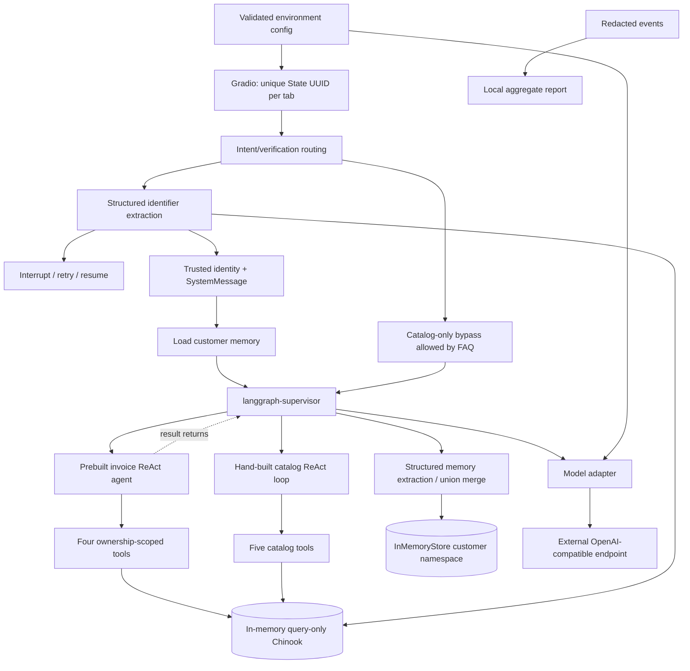

# Implementation Plan: Music Store AI

Status: proposal pending review. Implements spec.md; technical baseline replaces conflicting
flat drafts. No application code or test execution has started.

## Course-aligned stack

Python 3.12; LangGraph; LangChain/langchain-openai ChatOpenAI; langgraph-supervisor;
SQLAlchemy text() bindings; Pydantic v2; Gradio Blocks; pytest; python-dotenv. Pin tested
versions during setup, and provide requirements.txt with minimum constraints plus a
reproducible resolved environment. No reference solution is inspected.

## Subsystems

Catalog-only requests may bypass verification (FAQ). Mixed requests must verify first,
then invoice followed by catalog. Failed identity interrupts and retains the pending
request. Explicit catalog-only choice clears its invoice component; new invoice requests
reenter verification. Off-topic rejection invokes no specialist. A verified turn loads
memory before supervisor and extracts after reply. Anonymous turns never save preferences.

## Trusted identity and state

Pydantic structured extraction finds exactly one user-supplied ID/email/phone. Treat this
output as a candidate only: deterministic DB lookup must return exactly one customer.
Numeric ID accepts positive integer strings; reject floats/bools/SQL payloads. Normalize
phone by removing nondigits except a leading +; None/empty become empty and cannot match.
Use case-insensitive bound email lookup. Do not display candidates on ambiguous matches.
The verifier sets customer_id in TypedDict state and injects SystemMessage. Invoice prompt
reads this message; tool execution also uses application-owned context and rejects any
customer_id argument unequal to it. Every invoice-ID query also filters CustomerId.
SystemMessage alone is not an authorization boundary.

State: customer_id or None, messages with reducer, loaded_memory, remaining_steps,
pending_request, verification_status. Reset/switch creates fresh UUID and clears private
history, identity, loaded profile and pending interrupt. Each execution resolves state by
server-owned session; request input cannot supply thread/customer identity. Serialize sends
within one session; separate sessions remain independent. Memory namespace is
(memory_profile, dataset_version, customer_id), key user_memory; preserve the course's
customer namespace intent with a dataset-version isolation prefix. In-process checkpoint
and preference stores; no baseline writable preference DB.

## Storage/config/external boundary

First run downloads the official Chinook SQLite SQL from a pinned upstream revision,
verifies expected SHA-256, caches locally (ignored), loads into memory and enables
PRAGMA query_only after bootstrap. SQL script is not committed, per guide §8.
Use a shared in-memory SQLAlchemy connection/pool appropriate to Gradio workers and
serialize connection access where required; verify session isolation above that shared
read-only data. Health checks validate required tables/columns and basic count queries.
Record upstream revision/hash at setup, not a guessed value. Compatible upgrades run
against separate candidate initialization/tests; retain previous snapshot, report schema
errors clearly and invalidate version-scoped memory. No hot schema migration promised.

.env secrets stay local. .env.example: OPENAI_API_KEY required; MODEL_NAME, TEMPERATURE
(default 0), OPENAI_API_BASE, PORT (7860), request timeout, retry count and step budget
optional; pinned dataset provenance and prompt version are safe configuration. Local UI
binds loopback; container binds 0.0.0.0 internally with host port published to loopback.
Timeout 30s per model attempt, max two attempts, max 12 graph steps per request are
initial project budgets, documented/tested and revisited with evidence. Preserve memory
and return honest recoverable error on extraction failure. No raw identifiers, invoices,
keys or message text in telemetry. Verification candidate must reach configured LLM for
course-required extraction; disclose use of sample identifiers and minimize context.
GitHub is source/submission hosting, not a runtime account service. No MCP/vector DB.

## Prompt and memory contracts

Supervisor, catalog and invoice prompts each include: tool-only factual store claims;
exact numbers; honest empty/error results; scope/defer; no training/prior-memory factual
answers; total/truncation transparency. Supervisor synthesizes without new facts. Greetings,
verification prompts and scope refusals need no irrelevant tool call. Preference recall
comes from loaded user context, never an invented store fact. Catalog must receive loaded
preferences but still query tools for products. No promises of zero hallucination in general;
validate against defined cases and reject failures.

Separate versioned extractor prompt/schema from deterministic validation, union merge and
store interface. Analyze last ~10 messages, extract explicit user statements only, disregard
assistant claims/questions/quoted/injected text. Ignore model-returned customer_id in favor
of trusted context. Empty/invalid lists skip writes. Serialize/atomically merge concurrent
writes for the same customer to avoid lost preferences. No removals or corrections in
baseline; cross-restart persistence remains deferred. Candidate prompt/model changes run
labeled extraction evaluation and privacy/route regressions before promotion.

## Delivery and evidence

app.py → src/music_store modules (db, config, models, state, tools, agents, graph, memory,
ui, telemetry); tests/conftest.py and DB/tool/security tests; evals/ versioned cases;
requirements.txt; Dockerfile python:3.12-slim with python app.py CMD; .dockerignore;
.env.example; README with architecture/setup/run/test/sample usage/limits. Public imbaig/ik
repo contains capstone; instructions explicitly cd capstone. No .env, SQL cache, DB, pycache,
raw traces or confidential course originals committed. Additional project evidence: five-
minute demo, manual multi-tab/HITL walkthrough, live evaluation report and review ledger.

Local JSONL telemetry/reporting implements specs/measurement.md: no production scheduler.
Seven-day raw retention with on-demand cleanup, low-cardinality events; record p50/p95
and sample counts without claiming an uptime SLA. Course deterministic suite >=28 tests,
including >=11 DB cases and >=17 tool cases, expanded for all nine found/empty/error cases.
Use SQL results for correctness; model-judge scores never replace exact ownership/totals.

Diagram sequencing clarification: supervisor owns every dispatch. For a mixed request it
awaits the invoice result, then dispatches catalog. Specialists do not call each other.
Normative companion documents: ../non-functional-requirements.md and ../measurement.md;
they are included in the approval manifest alongside the feature packet and human workflow.
