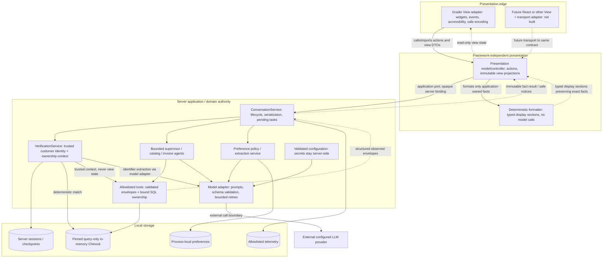

# Proposed architecture — lightweight layered server-backed chat

**Canonical design for feature002; proposal, not implemented or accepted as a revised spec.**
Binding source: [Imran's full architecture requirement](https://github.com/imbaig/ik/pull/6#issuecomment-6730142179),
2026-11-08; finding H5-04. This selects a presentation-boundary requirement, **not** a visual
direction, frontend migration, MVVM library, API service, merge or implementation permission.
Latest binding clarification: [Imran's app-specific layered architecture direction](https://github.com/imbaig/ik/pull/6#issuecomment-6734378270).
This supersedes strict MVVM interpretations: no Microsoft MVVM framework, dependency or
mandatory ViewModel class hierarchy. MVVM is background inspiration only; the architecture
is chosen for this Python, Gradio and agent-workflow application.

Current code reference: `252a454658d38c6fbc8854922f6a1bb1e3a00d50`; app source unchanged
from merged main `8138e7d1c02e759e758c328ccf8b84c25413e4bc`. Approved001 and snapshots
remain immutable. [Plan](plan.md), [acceptance](acceptance.md), [traceability](traceability.md).

## 1. Current implementation versus proposed extraction

These are source observations, not a claim that the proposed modules already exist.

| Current source | What exists now | Proposed responsibility change, only after approval |
|---|---|---|
| `src/music_store/ui.py` | `build_ui` creates Gradio widgets/events; `_View`/`UIController` keep display history, waiting flag, opaque handle mapping and locks; `output` produces Gradio update tuples | Keep widgets/layout/events/accessibility bindings and Gradio updates in View adapter. Extract action orchestration, framework-neutral display state and recovery mapping to presentation controller; no authorization moves into it |
| `conversation.py` | Server session registry/locks/history/pending request, lifecycle, verification routing, memory orchestration and safe notices; `ConversationReply` carries text plus structured records/status | Keep authoritative lifecycle/routing here. Introduce an explicit application result DTO/projection; migrate fixed notices to typed codes/data and fact sections, preserving semantics rather than parsing prose |
| `verification.py`, `identity.py` | Server verification state, interrupts/retries, deterministic identifier match, trusted identity, guarded tool context, reset/close | Stay authoritative. UI-facing verification summary is read-only projection; no second identity/pending-request state machine in presentation |
| `agents/runtime.py` | Bounded agent/tool execution, observed records, safe result/status; `render_records` builds customer text and is used instead of model-invented facts | Move customer-facing layout/record prose to deterministic presentation formatter. Retain tool result validation, execution budgets, ownership context and fact provenance in agents/application; do not replace grounding with a formatting test |
| `tools/domain.py`, `db.py`, `memory.py`, `config.py`, `model.py`, `telemetry.py` | Fixed SQL/ownership, pinned query-only DB, process memory, configuration/model assembly and redacted events | Keep these roles; no view/markup/Gradio dependency introduced. Composition root injects the application service/ports and formatter |
| `conversation_eval.py`, tests | Existing evaluation imports runtime renderer and checks exact tool-backed rendered text alongside SQL truth | Migrate renderer import and add structured/semantic assertions while preserving SQL/ownership oracles and live-vs-double distinction; update exact-text baselines deliberately |

Current `ConversationReply.text`/`AgentResult.text` and structured records coexist; the new
contract below is **proposed**, not their existing signature. Current raw row rendering is
not evidence the formatter boundary has already been extracted. The historical flat
[specs/design.md](../design.md) is a superseded draft, not current runtime documentation.

## 2. Subsystems, dependencies and fact flow

Arrows labeled “calls/imports” show allowed dependency direction; result arrows show data
return, not a reverse import. Storage/config are server-side. No network adapter is required
between Gradio callbacks and the in-process presentation/application contract.

Composition root (`app.py`/`model.py` today) wires dependencies. Neither the View nor formatter
loads environment secrets, calls SQL/LLM, imports tool executors or chooses a customer. Config
is not a browser DTO. The LLM is an external runtime dependency, not a renderer or authority.
This documentation task does not invoke it. Trace payloads never carry raw account/identifier
text, full view state or provider exceptions.

## 3. Proposed framework-neutral contracts

Contract names/fields below are design notation, not added code. Proposed neutral
`application_contracts.py` owns Action, ApplicationResult, FactSection and ApplicationPort;
`presentation/contracts.py` owns ViewState, DisplaySection and ViewPort and may import the
neutral application types. Application services never import presentation contracts. Plain immutable Python
DTOs/protocols are sufficient; no reactive/MVVM library, HTTP layer or public endpoint now.
No Gradio components, `gr.update`, LangChain messages or framework events cross these ports.
Markdown/HTML are optional encoded outputs, **never the sole machine/result contract**.

### Actions and lifecycle port

A server-created `ViewBinding` resolves to one active application conversation plus a
monotonic display generation. It is an opaque reference, not trusted customer identity.
Gradio State holds only the adapter's opaque binding; presentation stores the mapping on
the server. Unknown/expired/foreign bindings fail closed. Browser-supplied identity badges,
customer IDs, hidden form fields and cached state cannot establish or change authorization.

| Action | Input / result semantics | Guard and current behavior preserved |
|---|---|---|
| Open / Close (lifecycle) | Open allocates fresh server session/binding; Close invalidates and disposes view projection via service close | No identity or preference inferred; expiry/cleanup uses application lifecycle, not view GC alone |
| Send | Bounded message text; controller emits indeterminate Busy then calls application send; application owns request correlation and routing | Per-session serialization and duplicate-send handling; application checks authoritative waiting/identity, not a client view flag |
| ResumeVerification | One identifier response for the pending server task; application performs reply/retry and returns outcome | Current service routes `send(..., action="retry")` to verification while waiting. Future explicit action checks authoritative waiting before delegation; no new verifier algorithm. Do not echo/persist raw identifier as display history or telemetry |
| CancelVerification | No identifier text; maps to existing verification cancel action; safe cancelled outcome | Only valid while awaiting verification. Clears the server pending request; does not revoke an existing verified identity or cancel a model call |
| ContinueCatalogOnly | No identifier text; maps to existing `catalog_only` action, cancels account part and runs permitted catalog continuation | Offered for mixed pending tasks; application independently validates eligibility, never trusts button visibility. Later account question re-verifies |
| Reset | Optional proposed confirmation belongs to presentation; only Confirm calls application reset; Keep leaves binding/history unchanged | Under server serialization, invalidate old handle/checkpoint/private history/pending task, allocate fresh handle; increment display generation and clear private projection. Saved process preferences are not deleted |

State-aware eligibility is returned as server-derived **display hints**. The application must
revalidate every action on execution; an `available_actions` list is not an authorization
capability. Pending request contents and verification retry count remain server-owned.
A Send received while waiting follows the existing identifier-response semantics; explicit
Resume is the future adapter intent, not a second path that can bypass the verifier.

### Application result DTO (proposed projection)

`ApplicationResult` carries: server request correlation, lifecycle/generation association,
completion status, branch/section outcomes, verification-required/verified/expired projection,
allowed-action hints, immutable ordered `FactSections`, and typed safe notices/errors.
Each fact section identifies its originating supported tool and observed envelope:
`status`, ordered typed `rows`, `total_count`, `returned_count`, `truncated`, any
`distinct_artist_count`, safe message/error code. Preserve relevant metadata without leaking
raw SQL, internal prompts or secrets. Existing ownership checks happen **before** this DTO.

Non-fact outcomes (welcome, switch refusal, cancellation, memory update/recall, limitations)
use allowlisted notice codes and validated literal values from application outcomes. Memory
values are profile evidence, not catalog facts. No generic model-authored string is promoted
to store fact because it arrived in a `text` field. A staged compatibility bridge may retain
legacy safe text temporarily, but new adapters must use typed outcomes and observed facts;
no parsing JSON out of rendered Markdown and no implicit authority from prose.

### Presentation view state (proposed projection)

| Field family | Meaning and ownership |
|---|---|
| Conversation items / display sections | Immutable ordered customer-safe projection derived from app results; renderer owns labels/layout, not new facts. No cross-session cache |
| Phase | `empty`, `busy`, `verification_required`, `result`, `error`, `expired` from current action/result; not a parallel authoritative verification machine |
| Verification indicator / safe pending-task label | Read-only application-derived hints; no trusted `customer_id`, customer namespace, verifier checkpoint or executable pending request duplicated here |
| Status / progress | Allowlisted status code + safe parameters; progress only indeterminate “Working…” and elapsed duration supported by actual events; no percentage, token, tool-phase or completion claims from a timer |
| Action hints / input affordance | Enabled/disabled/visible projections, including mixed-only catalog continuation and reset confirmation consequences; service rechecks everything |
| Correlation / generation | Server-assigned binding generation and request association used to discard stale delivery; never an account selector or caller-controlled authorization field |
| Failure | Safe typed outcome and retry/new-conversation affordance, not stack trace/provider text; distinguish empty successful lookup from failure and partial mixed results |

The presentation controller owns only display transitions, draft handling and per-binding
presentation concurrency; domain history, pending request, customer/profile authority and
verification transitions stay in application services. Any returned entity identifier used
for a follow-up remains untrusted input to guarded tools, never proof of ownership.

## 4. Exact facts, deterministic formatting and safe encoding

The formatter accepts only validated application-owned fact DTOs; it is a pure function
with no SQL, model, identity lookup, preference mutation, time-dependent facts or Gradio.
It returns semantic display sections (labels, rows, lists, notices), not arbitrary HTML.
The View/transport adapter applies sink-specific safe text/Markdown/HTML encoding without
reinterpreting content. Plain text is a valid first implementation. Sanitization stays on.

- Preserve exact decimal **strings** as supplied, including precision; no float conversion,
  currency inference, silent rounding or replacement of recorded total with computed sums.
- Preserve IDs, quantities, row order, all returned requested facts, `returned_count`,
  `total_count`, truncation and section status; genre representative-track/artist counts remain
  distinct. No sample presented as a full set, no fabricated “load more” pagination promise.
- Preserve account-first mixed ordering and separate partial errors; no blanket success
  when one requested branch failed. Not-found/error/invalid-input remain distinguishable.
- Treat every string from users/tools/model/profile as data. Escape Markdown metacharacters
  and HTML at the selected sink; no raw tags, inline JS, unsafe URL schemes or auto-activated
  contact links. Encoding must not alter visible names/amounts or double-escape them.
- Validate envelope consistency (returned rows/count, truncation, status and required fields)
  and safe provenance. Unknown/malformed facts produce honest unavailable display, not an
  inferred zero-result or fabricated prose. Existing application/tool validation remains;
  formatter rejection is an additional display integrity check, not account authorization.
- Keep grounding guards in agents/services: facts originate only in executed allowlisted tools,
  account tools use trusted identity, and generated prose cannot introduce unobserved claims.
  Moving `render_records` must not remove these invariants or weaken SQL-truth graders.

## 5. Session, reset, cancellation and delivery rules

Server conversation/verification services continue to own UUID/session registry, locks,
identity, pending task and checkpoint invalidation. Process-local preferences retain existing
namespace/lifetime rules. Presentation never reauthenticates from “customer_id is now2” or
retained view state. Verification and model work still use the existing bounded services.

While an action is in flight, send/reset controls remain disabled and duplicate actions are
not queued blindly. Application locks remain the actual serialization boundary. Current
reset can wait for an active request lock; it does **not** interrupt that request/provider.
The proposed controller reports busy/does not optimistically clear a conversation when reset
cannot yet execute. Programmatic/transport callers must also pass server guards. Once reset
succeeds, clear private display state and detach old delivery before showing fresh unverified
state. Late replies tagged with old binding/generation/request association are discarded,
never briefly rendered into the new conversation. Unknown/stale/foreign handles fail closed.

**Cancel verification is not Cancel in-flight provider call.** It is an action on an already
waiting verification task. There is no Stop generation/provider-abort action in this proposal.
Closing a view or requesting reset is not proof the provider stopped; existing timeout/retry
bounds apply. No new token streaming, granular progress or background-job cancellation is
promised. Future transport streaming may deliver the same busy/final contract, but needs
ordering, disconnect, replay and stale-delivery validation before richer events are added.

Reset confirmation copy is proposed and not current code. Confirm clears conversation,
identity and pending work; Keep does not call reset; neither removes process preferences.
Demo identifier matching remains sample verification, not production authentication.

## 6. Allowed dependency direction and proposed module map

| Proposed file / port | Responsibilities and imports allowed | Not allowed |
|---|---|---|
| `application_contracts.py` (new, proposed) | Neutral Action/ApplicationResult/FactSection/ApplicationPort; imported by application and presentation; stdlib or existing schema library only | ViewState, presentation modules, Gradio, transport, SQL/model clients |
| `presentation/contracts.py` (new, proposed) | Immutable ViewState/DisplaySection/ViewPort; imports neutral application types | Gradio, transport, SQL/model clients, widget objects |
| `presentation/controller.py` (new, proposed) | Bindings/generations and display state, dispatch to application protocol, busy/result/error mapping, formatter calls; fake view can consume outputs | Customer verification/ownership decisions, pending-task executor or duplicated customer/profile authority |
| `presentation/formatter.py` (new, proposed) | Pure deterministic fact-to-semantic-display mapping; exact metadata/values and integrity checks | Agent/tool execution, app session mutation, Gradio or raw unsafe HTML |
| `ui.py` or `ui/gradio_adapter.py` (path to settle at implementation) | Existing Gradio View construction, callbacks, `gr.State` binding, `gr.update`, sink-safe rendering/accessibility | SQL/LLM/auth, authoritative identity or core transition logic |
| Existing `conversation.py` / app port adapter | Application result projection and trusted lifecycle methods; typed outcomes without presentation markup | Importing View, Gradio updates, formatting layout |
| Existing `agents/runtime.py` | Bounded execution, observed facts/status/provenance, ownership/grounding checks | Customer-facing record layout/Markdown templates after extraction |
| Existing verification/identity/tools/db/memory/model/config/telemetry | Retain authoritative roles; composition injects dependencies | Importing Gradio/View/presentation markup |
| Future HTTP/React adapter (not added) | Encode/decode typed contract; server-session binding/origin/CSRF/cache/lifecycle handling; frontend rendering | New customer authority, direct tool endpoints, browser credentials to model/database |

Core application/domain does not import the presentation package. Proposed
`presentation/application_adapter.py` wraps today's service signatures against the neutral
application port while the application-native result contract is introduced. Shared action/
result types live in `application_contracts.py`, not ViewState; this prevents an
application→presentation import cycle. A future frontend changes View/transport/integration,
not tool SQL or agent policy. This is a seam, **not zero-change replacement**: API/session
security, serialization, accessibility, deployment and tests cost work.

## 7. Migration and verification proposal — not executed

1. **Freeze behavior and contracts:** capture current tool/result/status fixtures and
   app/reset/ownership expectations; approve DTO boundaries and human design/spec before code.
2. **Extract framework-neutral presentation:** migrate `_View` display/history/dispatch/busy
   responsibilities from UIController; keep server lifecycle authority intact. Add fake-view
   tests with no Gradio import. Thin Gradio adapter retains working UI throughout.
3. **Extract formatter safely:** move `render_records` responsibility and literal notice
   composition into deterministic projection/formatting ports; keep observed record validation
   and grounding in runtime/application. Maintain a short-lived compatibility renderer until
   nine-tool and status parity passes; no circular imports or dual competing sources of facts.
4. **Wire adapter and retire bridge:** update controller outputs, safe encoding, eval renderer
   imports and expected deterministic presentation text. Preserve SQL-truth/ownership assertions,
   direct service tests and bounded routing; do not simply bless snapshots that lost facts.
5. **Validate:** proposed AC17–21 below acceptance.md; focused/fake-view/formatter/service tests,
   full offline pytest/Ruff, actual desktop/mobile/keyboard/a11y captures and affected exact-SHA
   live evaluation under existing workflow. No live/credential work in this docs amendment.
6. **Optional frontend substitution later:** only after a separate framework/transport decision;
   add protocol serialization/session/security/deployment tests and integration validation.
   No HTTP service, MVVM package, Node dependency or migration required by this pattern now.

Indicative author estimate, not measured commitment: 1–2 engineer-days contracts/controller
extraction, 1–2 formatter/compatibility work, 2–3 test/adapter/eval integration days plus human
review fixes. This overlaps, rather than adds mechanically to, earlier presentation estimates.
Future transport/frontend adds the separate API/session/deployment costs in feasibility.md.
Deadline remains November20; trade scope/date explicitly rather than weakening safety checks.

## ADR-002-01 — lightweight layered server-backed chat

**Decision constraint:** binding human requirement H5-04. **Document status:** proposed detailed
design, independent review/human acceptance pending; implementation not authorized.

Choose a View adapter plus framework-independent presentation model/controller and pure
formatter over the existing application/services. This is a lightweight layered design,
not a Microsoft MVVM implementation. Presentation state is a read-only projection, not
a second workflow or identity authority. No mandatory ViewModel hierarchy, two-way identity
binding, reactive framework, client-owned domain model or API-for-pattern-compliance is selected.

Rationale: the current UIController mixes Gradio updates with action/display logic, and agent
runtime owns customer record formatting. Extracting these improves testability and frontend
replaceability while preserving server authority, current Python/Gradio deployment and guards.
A fake View can drive actions without launching Gradio or calling a provider.

Tradeoffs: explicit DTO/version mapping, generation/lifecycle handling and formatter oracle
migration add work; presentation projections can become stale and must never authorize access.
Thin View adapters still need accessibility and integration tests. A generic all-purpose UI
framework would add unnecessary indirection; immediate React/API replacement would add security,
build/deployment and deadline risk. Retaining the mixed controller/renderer indefinitely would
leave substitution and deterministic presentation hard to test. These alternatives are not
newly implemented or selected framework migrations.

Human visual/framework/spec decisions and previous H5-01–03 closures remain separate. H5-04
cannot be self-closed: exact-revision independent review and Imran's acceptance are required.
