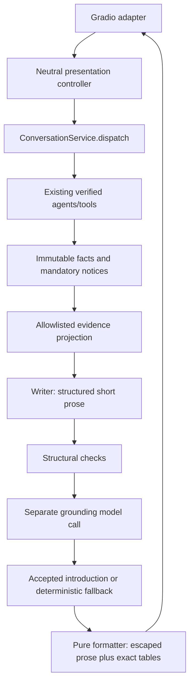

# Hybrid writer design and review record

Model orchestration belongs in application/model adapters, never presentation or SQL tools. Service.send legacy text and all factual row envelopes stay unchanged. ApplicationResult adds introduction, narration_status and elapsed_ms; notices stay separate and visible. Writer configuration default on in the real provider factory, optional injected dependency default absent in offline services; RESPONSE_WRITER_ENABLED=false disables creation/calls. Each SDK model uses max_retries0, timeout4s, max_tokens350, temperature from existing settings. Two sequential calls may add approximately8s plus overhead; not a hard wall-clock guarantee.

Both writer and grounding model receive the identical evidence projection. Catalog request capped2000chars; first8 labels persection,120chars perlabel; counts/status/truncation retained. Account or mixed scope removes original question, ALL rows/catalog labels and notice text (preferences may be private); generic scope and tool names/counts/outcomes only. No history, identifiers, billing, contact or profile passed. No domain tools bound; schema-return function only.

Model prose is untrusted. Maximum500chars, no HTML/links/multiline/unsupported numeric values or completed financial actions. Separate model gate may reject each draft; any exception/refusal/invalidschema/rejection falls back, without another attempt. This gate is probabilistic and correlated with writer model, not a proof of truth. Mandatory notices cannot be removed; exact tables remain separately rendered. Empty catalog fallback suggests spelling/title/genre; account empty states retain privacy-safe inaccessible wording. Error is not treated as empty inventory. Facts-free errors get a friendly retry explanation without another model call.

Independent spec reviewer /root/hybrid_spec_review, model metadata not captured, read003/002/governance before implementation: no fundamental blocker. Author ACCEPTED clarifications: pure formatter; both-model private evidence allowlist; distinguish unknown/error/empty; document SDK timeout overhead/retry0; probabilistic judge; include adversarial, disabled, privacy and table-equality tests. Reviewer did not edit/callprovider. User authorized hybrid approach; final UX acceptance and merge remain pending.

Required code review and actual live evaluation results are recorded in PR conversation for exact revision. Targeted hybrid evaluation does not waive existing14/16 baseline/10/11 issues. Session expiry issue23 remains separate; never claim it fixed here. Current phone7876 preview preserved; hybrid preview uses7877. No deployment, provider change or framework migration.
