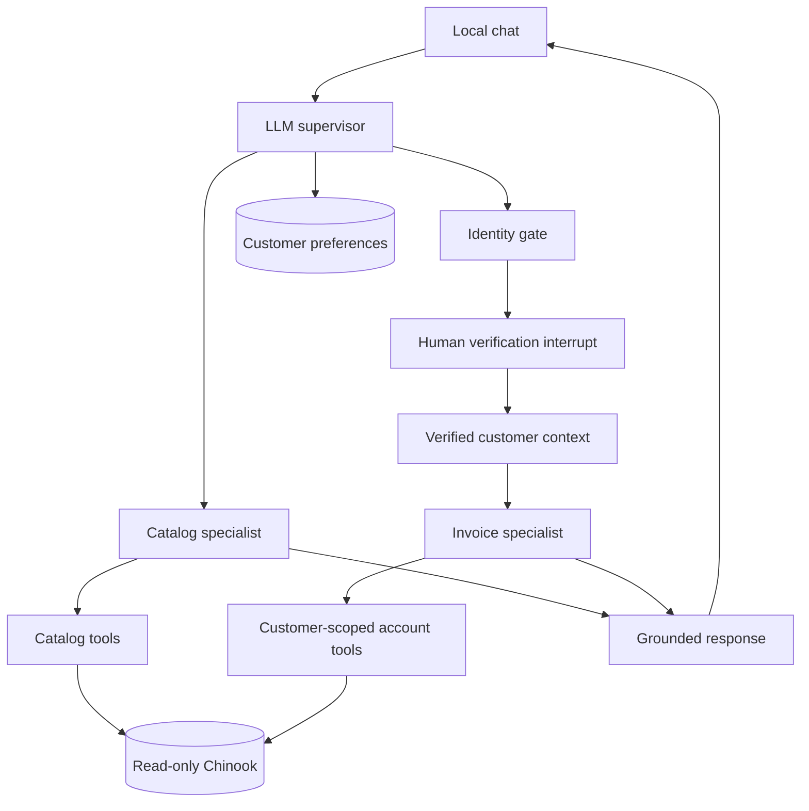
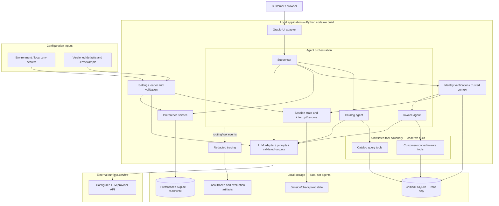

> **Architecture navigation — current versus proposed (PR6 amendment).** Current application
> code is [ui.py](../src/music_store/ui.py), [conversation.py](../src/music_store/conversation.py)
> and [agents/runtime.py](../src/music_store/agents/runtime.py); it has **not** been refactored
> into the proposed presentation boundary. Approved baseline context remains
> [001-music-store/plan.md](001-music-store/plan.md) and its unchanged approval records.
> **Canonical proposed UX architecture: [002-customer-experience/design.md](002-customer-experience/design.md)**
> (lightweight layered server-backed chat, contracts, dependency diagram, formatter extraction and ADR).
> Imran requires that separation; detailed revised-spec acceptance/implementation remain pending.
> The historical draft below is preserved unchanged for provenance, including superseded storage
> descriptions; it is not a description of the current runtime or approval of feature002.

> Superseded draft: current proposed baseline is [001-music-store/plan.md](001-music-store/plan.md).
> Historical content below remains for review provenance; conflicting details are not current requirements.

# Proposed design — Music Store AI

Python 3.12, LangGraph, SQLAlchemy, SQLite/Chinook, Pydantic and Gradio.
Validate package versions during setup. Model selection and credentials use environment
variables. These are design choices, pending final detailed-rubric review.

Application code supplies verified customer context outside model-editable arguments.
Every private query enforces customer ownership, including invoice line items. Knowing
an invoice ID never grants access. Failed verification leaves the gate closed; identity
switching clears previous private context. Catalog access remains public.

Each specialist has bounded tools and grounding instructions. Mixed queries use both
specialists and combine observed results. User input and database strings are data,
not instructions. Do not provide the entire customer table to the LLM.

Obtain the official Chinook database and record provenance/license. Use a separate
writable SQLite preference store. Capture explicit preferences and merge sets; a search
question does not imply a preference. Conversations are session-scoped; persistent
preferences are customer-scoped.

Trace routing/tool names/durations without secrets or full identity records. Fake-model
tests prove transitions, not live reasoning quality. Live evaluation compares answers
with database truth and records model/configuration plus commit SHA.

## Subsystem boundaries and ownership

This view is part of the design baseline, before implementation. All components below
are proposed; a diagram box does not mean the component already exists.

| Boundary | What we code | Storage/configuration | External calls |
|---|---|---|---|
| UI | Chat rendering, session creation, verification form/resume | Session identifier | Browser to loopback app |
| Orchestration | Routing, specialist prompts, bounded loops, mixed-query synthesis | Session history, pending interrupt, trusted identity | Through LLM adapter only |
| Identity | Identifier matching, normalization, verified context, reset on identity change | Read sample customer rows; session identity | None |
| Tools | Typed arguments, fixed parameterized SQL, row limits, customer ownership checks | Read-only Chinook | None |
| Preference memory | Explicit-preference extraction/validation and set-union merge | Separate writable SQLite | LLM extraction, if used, through adapter |
| Model adapter | Client wrapper, timeout/retry policy, output validation, test double interface | Model/provider and timeout settings; environment credentials | LLM API |
| Configuration | Typed settings loader and startup validation | Safe defaults in Git; secrets in environment | None |
| Observability/evaluation | Redaction, event capture, scenario runner and reports | Local traces; curated reports in Git | Live evaluation invokes configured LLM |

### Libraries versus application code

We write domain behavior and integration code. Python, LangGraph, SQLAlchemy, Pydantic
and Gradio are third-party libraries installed into the local environment, not separate
hosted services. LangGraph provides graph execution and interrupts; SQLAlchemy executes
our fixed queries; Pydantic validates contracts; Gradio supplies UI components. Exact
versions and model selection are finalized and locked during environment setup.

Chinook is the source of catalog/account facts. Preference storage is application-owned
state. Neither database is an LLM. No vector database, embeddings, RAG pipeline, MCP
server, payment system or ticketing platform is needed for the current music-store scope.

### State lifecycle

- Chinook: provision from an attributed official sample; application opens read-only.
- Preferences: persistent SQLite, keyed by verified customer, writes restricted to
  validated preference operations.
- Sessions/checkpoints: isolated by opaque session ID; verification and conversation
  state expire with the session. The initial local demo uses an in-memory checkpointer;
  restarting requires verification again while saved preferences remain.
- Configuration: version `.env.example` and safe defaults; ignore `.env`, keys and local
  overrides. Proposed settings include model/provider, database paths, request timeout,
  retry limit and localhost binding. Reject invalid settings at startup.
- Logs: omit credentials and raw verification fields. Version curated evaluation evidence;
  ignore runtime databases and raw local traces.

### External service and trust boundaries

The LLM receives only the prompt/history and minimum tool results needed for the current
request. Raw verification input is handled by application code; trusted identity is not
accepted from a model argument. The application, not the LLM, authorizes every private
query. Database/tool outputs are untrusted text for instruction purposes.

GitHub hosts source and submission artifacts during development; it is not a runtime
account-data service. Package registries and the Chinook source are setup dependencies.
Hosted tracing is optional and disabled by default. No model can execute arbitrary SQL
or arbitrary shell commands through the application tools.

## Application agent stack versus development workflow

The product's supervisor/catalog/invoice agents run inside the music-store application.
They do not design, review or approve their own source code.

The development workflow uses Codex in this chat for specification and implementation,
local shell/Git for reproducible changes and checks, and browser interaction for UI
validation. Imran owns scope decisions and milestone approval. Automated checks produce
evidence; they do not provide human approval. See
[review workflow](../docs/development-review-workflow.md) and
[audit ledger](../docs/audit-ledger.md).

## Review clarifications — HUM-001–009 (proposed resolutions)

### UI choice and assignment alignment

Gradio is explicitly the expected framework in the music-store milestones/FAQ; changing
framework requires program-coordinator confirmation. Use Python 3.12 and Blocks with
messages-type chat, text input, Send, and New conversation/reset controls. Validate
verification interrupt/resume and independent session State/UUIDs. This is course
alignment, not a claim that any generated Gradio UI automatically earns full credit.

### Customer and session boundary

A chat contains one active verified customer. It is not a shared multi-user room. Many
customers may use separate concurrent browser sessions. A second person on a shared
browser selects Switch customer/New conversation: clear display/history, identity, loaded
memory and pending actions; allocate a new thread and reverify. A free-text customer ID
never switches identity. The catalog is public under our proposed design; reconcile the
milestones' verify-first graph with this before baseline approval.

### HC-03 failed-verification experience

Example: “Show my latest invoice and albums by Iron Maiden.” If the ID is not found:
“I couldn't find an account with those details. Check them or try your registered email
or phone. I haven't accessed any invoices.” Offer Retry verification, Continue catalog
only, or Cancel/New conversation. Do not list possible customers or confirm another
person's details. Catalog-only continuation must say the invoice part is still pending;
resume invoice-first mixed execution only after successful verification. Any successful
catalog answer still comes from catalog tools. Never claim the whole request succeeded
when the account branch remains blocked. Repeated failures must remain bounded and
recoverable; no invented account/contact information.

### Evolving memory behavior without redesign

Give memory extraction its own versioned prompt, structured UserProfile schema and
interface: extract(recent_messages, existing_profile) → candidate_preferences. Put policy
validation/set-union merge and storage in separate deterministic code. The extractor
cannot change verified identity or run SQL. Empty/invalid output preserves old data.
Keep prompts/config versions in evaluation metadata; compare candidate extractor/prompt
versions on labeled explicit/question/negation/quoted/ambiguous cases before promotion.
Routing, tool, privacy and memory regression checks guard the change. Prefer prompt,
examples, schema or model-configuration adjustments first; model fine-tuning is not
required. Schema/interface changes can still require migration and broader review.
An additive correction/deletion policy needs an explicit decision because the course
requires union-only memory; do not silently add deletion semantics.

### Storage and configuration reconciliation

The earlier file-backed Chinook diagram is a superseded draft proposal: course-aligned
baseline loads pinned cached SQL into in-memory SQLite and enforces query-only access.
See non-functional-requirements.md for update validation and rollback. Preference storage
across process restarts is optional pending scope approval, not yet a baseline guarantee.

### Document map

`specs/` describes what must be built and how it will be validated: requirements, quality
attributes, design, measurement, acceptance and implementation tasks. Under Spec Kit,
reconciled feature packets will contain spec.md, plan.md and tasks.md under a numbered
feature folder. `docs/` explains and records the project: business narratives, decisions,
review reports, audit ledger, run/demo guides and evidence. Mandatory behavior described
in a docs use case must have a requirement/acceptance link in specs; do not create two
competing normative sources. Existing flat drafts stay labeled until migration/review.

Non-functional criteria: [non-functional requirements](non-functional-requirements.md).
Business/operational reporting: [measurement](measurement.md).
